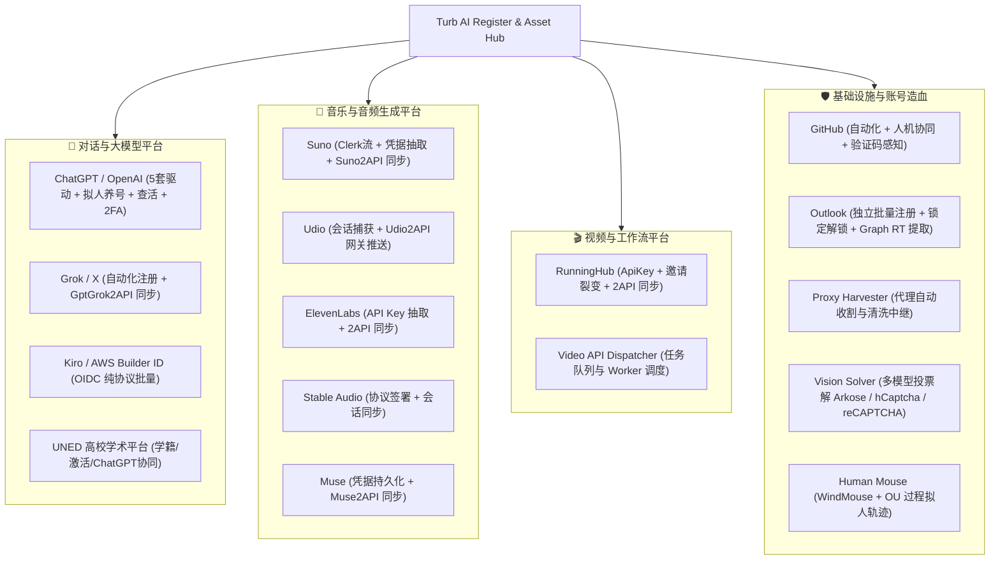

# Turb AI Register & Asset Hub (全能 AI 账号矩阵注册与资产中枢)

> 本项目已从最初单纯的 ChatGPT 注册器，深度升级演进为**全矩阵多平台自动化账号注册、风控攻防、凭据提取、网关同步与资产管理中枢**。  
> 现已打通对话模型（ChatGPT/Grok/Kiro）、音频生成（Suno/Udio/ElevenLabs/StableAudio/Muse）、视频工作流（RunningHub/Video API）、开发者与学术平台（GitHub/UNED/Outlook/Gmail）全业务线，并深度集成了通用视觉大模型验证码求解、拟人反爬轨迹、多代理智能路由与自动收割造血生态。
> 
> 🚀 **【统一调度中枢与插件化升级】**：全平台注册命令已 100% 收敛至统一中枢 **`python turb.py run <platform>`**！Agent 与人类操作员**无需阅读任何底层代码**即可秒级自省与调度全平台！
> 👉 **[【必读任务书】全平台操作指南与任务书 (TURB_OPERATIONS_MANUAL.md)](./TURB_OPERATIONS_MANUAL.md)** 👈  
> 👉 **[【Agent 调度契约】零代码阅读自省法则 (AGENTS.md)](./AGENTS.md)** 👈  
> 👉 **[【前沿技术规范】2026 前沿攻防架构升级说明书 (UPGRADE_SPEC.md)](./UPGRADE_SPEC.md)** 👈

---

## 目录
- [【核心必读】2026 前沿架构升级与新特性说明书 (UPGRADE_SPEC.md)](./UPGRADE_SPEC.md)
- [一、全景架构与支持平台矩阵](#一全景架构与支持平台矩阵)
- [二、新增多平台自动化注册指南](#二新增多平台自动化注册指南)
  - [1. Grok (X/Twitter) 自动化注册与 GptGrok2API 同步](#1-grok-xtwitter-自动化注册与-gptgrok2api-同步)
  - [2. Kiro (AWS Builder ID) 纯协议注册与凭据导出](#2-kiro-aws-builder-id-纯协议注册与凭据导出)
  - [3. AI 音乐与音频生成矩阵 (Suno, Udio, ElevenLabs, StableAudio, Muse)](#3-ai-音乐与音频生成矩阵-suno-udio-elevenlabs-stableaudio-muse)
  - [4. AI 视频与工作流平台 (RunningHub, Video API)](#4-ai-视频与工作流平台-runninghub-video-api)
  - [5. GitHub 自动化与人机协同助手](#5-github-自动化与人机协同助手)
  - [6. Outlook 独立造血、自动解封与 Graph RT 提取](#6-outlook-独立造血自动解封与-graph-rt-提取)
  - [7. UNED 高校学术平台与学生身份](#7-uned-高校学术平台与学生身份)
- [三、通用视觉验证码求解器 (Vision Solver) 与攻防引擎](#三通用视觉验证码求解器-vision-solver-与攻防引擎)
- [四、全流程端到端自动化编排 (Full Flow & Reg Loop)](#四全流程端到端自动化编排-full-flow--reg-loop)
- [五、ChatGPT / OpenAI 核心机制与深度配置手册（原版完整保留）](#五chatgpt--openai-核心机制与深度配置手册原版完整保留)
  - [1. 注册驱动与多环境支持 (Protocol / Roxy / Cloak / Browser Use / Skyvern)](#1-注册驱动与多环境支持-protocol--roxy--cloak--browser-use--skyvern)
  - [2. 浏览器网络流量统计与本地省流量模式](#2-浏览器网络流量统计与本地省流量模式)
  - [3. JS 执行覆盖率分析 (CDP Profiler)](#3-js-执行覆盖率分析-cdp-profiler)
  - [4. 全渠道邮箱来源详细配置规范 (9类邮箱)](#4-全渠道邮箱来源详细配置规范-9类邮箱)
  - [5. Codex OAuth 授权与接码平台](#5-codex-oauth-授权与接码平台)
  - [6. WebUI 控制台与授权管理](#6-webui-控制台与授权管理)
  - [7. 数据存储与 SQLite 现代化仓储](#7-数据存储与-sqlite-现代化仓储)
  - [8. 常见问题排查 (FAQ)](#8-常见问题排查-faq)
- [六、网络基础设施 (Proxy Harvester & Router)](#六网络基础设施-proxy-harvester--router)
- [七、维护工具与资产导出清单](#七维护工具与资产导出清单)
- [八、项目目录结构](#八项目目录结构)

---

## 一、全景架构与支持平台矩阵



### 全平台特性与资产支持清单

| 平台分类 | 目标平台 | 核心驱动 / 协议 | 产出资产与网关对接 | 核心特色 |
|---|---|---|---|---|
| **大模型** | **ChatGPT / OpenAI** | Protocol / Roxy / Cloak / Browser-Use / Skyvern | Access Token / Refresh Token / Codex OAuth / CPA / SUB2API | 5套注册驱动可选，支持年龄/生日/密码表单自动补全、2FA、邮箱换绑、拟人养号 |
| **大模型** | **Grok (X/Twitter)** | Chromium 自动化 + SSO 协议 | SSO Token / 会话 Cookie -> **GptGrok2API** | 支持单号与高并发批量注册，会话实时保活与失效自动恢复 |
| **大模型** | **Kiro (AWS Builder ID)** | OIDC 纯协议网络流 (`curl_cffi`) | AWS SSO Token / CodeWhisperer 长期凭据 | 纯协议实现，内置 AWS 指纹算法，批量产出长期可用凭据 |
| **学术平台** | **UNED** | 自动化网页流 + 验证码对接 | 学员凭据 / 自动化跑通 | 动态生成真实学生画像，自动过码，完成学籍激活，可赋能教育特权账号 |
| **音频/音乐** | **Suno** | Playwright Chromium 驱动 | Clerk Client ID / Session JWT -> **Suno2API** | 智能处理新版 Clerk 认证，本地 SQLite 持久化，一键批量推送至 API 网关 |
| **音频/音乐** | **Udio** | Playwright Chromium 驱动 | 认证 Cookie -> **Udio2API** | 自动绕过 Cloudflare 挑战，捕获全套鉴权 Cookie 并入库推送 |
| **音频/音乐** | **ElevenLabs** | Playwright Chromium 驱动 | XI-API-KEY / Session -> **Elevenlabs2API** | 自动化完成注册引导，直接生成/捕获有效 API Key 并推送到网关 |
| **音频/音乐** | **Stable Audio** | Playwright Chromium 驱动 | 鉴权 Cookie -> **StableAudio2API** | 自动模拟签署 Terms of Service 协议卡片，提取完整会话 |
| **音频/音乐** | **Muse** | Playwright Chromium 驱动 | Session 凭据 -> **Muse2API** | 自动化交互流，凭据入库与接口同步 |
| **视频工作流** | **RunningHub** | Playwright Chromium 驱动 | API Key / 邀请返利 -> **RunningHub2API** | 自动化完成账号注册，提取 API 密钥，自动填写裂变邀请码并检测到账状态 |
| **视频工作流** | **Video API Dispatcher** | 异步任务管理器 (`asyncio`) | 任务轮询与 Worker 队列 | 后台轮询、视频生成任务分发与进度追踪调度核心 |
| **开发者平台** | **GitHub** | Playwright + 人机感知机 | 账号密码 / 会话 Cookies | 支持全自动/半自动人机协同双通道，自动提取邮箱 OTP，已对接视觉验证码求解 |
| **身份与邮箱** | **Outlook** | BitBrowser / Playwright / Requests | `email----pass----clientId----refreshToken` | 独立批量注册、锁定账号自动化解锁、免密纯 HTTP 提取 Microsoft Graph RT |

---

## 二、新增多平台自动化注册指南

### 1. Grok (X/Twitter) 自动化注册与 GptGrok2API 同步
位于 `core/grok/` 与 `tools/`。
```bash
# 启动 Grok 单号交互式/自动注册
python tools/register_grok_single.py

# 启动 Grok 并发批量注册并自动推送到 GptGrok2API 网关
python tools/register_grok_concurrent.py --workers 3

# 恢复并检测已保存的 Grok 会话有效性
python tools/recover_already_registered_grok.py
```

### 3. Kiro (AWS Builder ID) 纯协议注册与凭据导出
位于 `run_kiro_register.py`。通过 OIDC 协议直连 AWS SSO 端点，内置密码安全加盐与设备指纹计算。
```bash
# 纯协议批量注册 2 个 Kiro Builder ID 并导出长期凭据
python run_kiro_register.py --count 2 --email-provider temp --temp-provider yyds
```

### 4. AI 音乐与音频生成矩阵 (Suno, Udio, ElevenLabs, StableAudio, Muse)
每个音频平台均配备专用注册驱动与 SQLite 本地持久化，并支持向对应下游 `*2api` 服务一键推送：
```bash
# Suno: 注册 1 个账号并推送到 suno2api 网关
python run_suno_register.py --count 1

# Suno: 查看本地已注册账号列表与网关同步状态
python run_suno_register.py --list

# Suno: 一键将未同步账号批量推送至网关
python run_suno_register.py --sync-all

# Udio: 注册并同步至 udio2api
python run_udio_register.py --count 1

# ElevenLabs: 注册并提取 API Key 推送至 elevenlabs2api
python run_elevenlabs_register.py --count 1

# Stable Audio: 自动完成服务条款签署并提取会话
python run_stableaudio_register.py --count 1

# Muse: 注册账号并提取 Session
python run_muse_register.py --count 1
```

### 5. AI 视频与工作流平台 (RunningHub, Video API)
```bash
# RunningHub: 自动化批量注册、提取 ApiKey 并处理邀请返利
python run_runninghub_register.py --count 1

# 批量将本地未同步的 RunningHub 账号推送到 runninghub2api
python run_runninghub_register.py --sync-all

# Video API Dispatcher: 启动后台视频生成任务轮询与 Worker 队列
python run_video_api.py
```

### 6. GitHub 自动化与人机协同助手
位于 `interactive_github_register.py` 与 `core/github/`。
- 启动全自动 / 半自动人机双通道助手：
```bash
python interactive_github_register.py
# 或直接双击运行 launch_github_assistant.bat / run_github_register.bat
```
- 支持终端非阻塞按键监听（Enter 强制接管）与 DOM 自动感知；
- 支持自动读取邮箱 OTP 验证码回填。

### 7. Outlook 独立造血、自动解封与 Graph RT 提取
彻底打通邮箱供应链，兼备**外部采购导入**与**内部自主造血**：
```bash
# 1. 独立批量注册 Outlook 邮箱账号 (多模式自动回退)
python register_outlook_standalone.py --count 5 --concurrency 2

# 2. 纯 HTTP 提取微软 Graph API refresh_token (将普通 email----pass 转化为带 API 凭据的高价值资产)
python tools/extract_graph_tokens.py accounts.txt

# 3. 批量解锁被锁定的 Outlook 账号 (PerimeterX 穿透求解 + 解锁后直接回写 Graph Token)
python tools/unlock_outlook.py --input emails_locked.txt --concurrency 2

# 4. 批量执行 Outlook Graph 授权 (支持 HTTP 与浏览器双模式)
python tools/authorize_outlook.py --input accounts.txt --method http
```

### 8. UNED 高校学术平台与学生身份
位于 `core/uned/`。
```bash
# 运行 UNED 身份注册与激活流水线
python run_uned_register.py
python run_uned_activate.py
python run_uned_goal.py
```

---

## 三、通用视觉验证码求解器 (Vision Solver) 与攻防引擎

### 1. 视觉验证码通用求解器 (Vision Solver)
位于 `core/vision_solver/`。  
采用多视觉大模型（GPT-4o、Claude 3.5 Sonnet、Gemini 1.5/2.0、Qwen-VL）并发投票机制，彻底告别昂贵且易失效的传统第三方打码服务。

- **四类交互模式**：
  1. `grid_select`（DOM 多选网格）：适用于 reCAPTCHA v2 / hCaptcha。
  2. `single_pick`（单选旋转/匹配）：适用于 **Arkose Labs / FunCaptcha**（GitHub、Outlook、OpenAI 的旋转动物、方向匹配）。
  3. `canvas_grid`（纯 Canvas 像素级坐标选择）：识别卡片式与画布式挑战，无需 DOM tile。
  4. `canvas_drag`（Canvas 鼠标拖拽）：计算起始点并进行带物理抖动的分步拖放。
- **预置规则库**（`core/vision_solver/presets/`）：
  - `arkose_match.json`：Arkose 目标旋转匹配。
  - `hcaptcha.json` & `hcaptcha_drag.json`：新版 hCaptcha 坐标点击与滑块拖动。
  - `recaptcha_v2.json`：reCAPTCHA 九宫格/十六宫格选图。

**代码调用示例**：
```python
from core.vision_solver import solve, CaptchaSpec

# 加载 Arkose Match 预置规则
spec = CaptchaSpec.from_json("core/vision_solver/presets/arkose_match.json")
# 传入 Playwright Page 对象，大模型并发投票并在页面上自动完成过码
ok = await solve(page, spec)
```

### 2. 高仿真拟人鼠标轨迹算法 (Human Mouse)
位于 `core/human_mouse.py`。
- 基于 **WindMouse** 动力学模型（引力牵引 + 随机风力抖动 + 速度收敛与自然过冲）。
- 结合 **Ornstein-Uhlenbeck** 物理微颤动随机过程，专门击破 PerimeterX、Cloudflare Turnstile、DataDome 的行为特征检测。

---

## 四、全流程端到端自动化编排 (Full Flow & Reg Loop)

支持一键编排端到端多平台全自动闭环注册：

```bash
# 1. 端到端全流程自动流水线：从 Outlook 造血到 ChatGPT / Grok / Kiro / GitHub
python run_full_flow.py --platforms chatgpt grok kiro github

# 2. 并发处理 3 个邮箱，平台间按邮箱轮询分配
python run_full_flow.py --rounds 12 --concurrency 3 --platforms chatgpt grok kiro

# 3. 使用已有邮箱池多平台并发注册
python register_three_platforms.py --from-pool --parallel

# 4. 常驻注册循环守护进程 (Outlook 自动产号入池)
python outlook_reg_loop.py
```

---

## 五、ChatGPT / OpenAI 核心机制与深度配置手册（原版完整保留）

> 以下内容为原版项目核心架构与深度配置说明，完整保留并适配全新架构。

### 1. 注册驱动与多环境支持 (Protocol / Roxy / Cloak / Browser Use / Skyvern)

项目支持五套注册驱动无缝切换：

- **protocol**：原纯协议注册，基于 `curl_cffi` + Sentinel/PoW。
- **roxy**：RoxyBrowser 指纹浏览器 + Selenium 自动化注册，兼容新版页面流，例如 `create-account/password`、`about-you` 年龄/生日表单、地区本地化页面等。
- **cloak**：CloakBrowser + Playwright 适配层自动化注册，支持免费 binary、无头模式、humanize、固定 fingerprint seed、代理 geoip。
- **browser_use**：Browser Use Cloud stealth Chromium + Playwright（可选住宅代理，无需本机安装 Roxy）。
- **skyvern**：Skyvern Browser Sessions 云端浏览器 + Playwright CDP。

#### 驱动切换与兼容性
- 支持 RoxyBrowser 一号一环境：自动创建、打开、关闭、删除 Roxy Profile。
- 支持 Roxy 无头启动：`ROXY_OPEN_HEADLESS=True`。
- 支持 CloakBrowser：免费 binary、无头模式、humanize、固定 fingerprint seed、按出口 IP 自动匹配语言/时区/WebRTC。
- Roxy / Cloak 浏览器注册已兼容：
  - 填邮箱后直接进入邮箱验证码页；
  - 填邮箱后先进入 `create-account/password`，自动设置密码再继续；
  - `about-you/profile` 页面直接输入年龄数字；
  - `about-you/profile` 页面输入年月日生日；
  - React Aria birthday select / spinbutton 年月日控件；
  - 不同出口 IP / 不同页面语言下按钮顺序变化导致的三方登录误点问题。

---

### 2. 浏览器网络流量统计与本地省流量模式

浏览器驱动会从打开注册页开始统计，到注册后停留结束、浏览器关闭前完成汇总。结果包含：
- 上传字节、下载字节、总字节数；
- HTTP 请求数、失败/未完成请求数；
- WebSocket 帧 payload 字节（如流程使用 WebSocket）。

现代/Legacy WebUI 的注册任务列表会显示总流量，完整结构保存在任务记录的 `network_traffic` 和成功账号的 `extra_json` 中。统计为浏览器侧可观测的请求/响应流量，不包含 TLS/IP/代理隧道额外开销，也不包含邮箱 API、Roxy API 或 CDP 控制通道流量。

#### 省流量模式配置
在 WebUI「浏览器画像」中开启「本地浏览器省流量模式」，或在 `.env` 设置（仅 Roxy/Cloak 生效）：

```dotenv
BROWSER_DATA_SAVER_MODE=True
BROWSER_DATA_SAVER_BLOCKED_RESOURCE_TYPES=["image", "media"]
# URL glob 列表；WebUI 中则是一行一条
BROWSER_DATA_SAVER_BLOCKED_URL_PATTERNS='["**://auth.openai.com/awe/api/v2/rum**", "**://chatgpt.com/ces/statsc/flush**", "**://connect.facebook.net/**", "**://analytics.tiktok.com/**", "**://snap.licdn.com/**", "**://bat.bing.com/**", "**://accounts.google.com/gsi/client**"]'
```

Roxy/Selenium 会在启动参数中关闭图片加载，并使用 Chrome CDP 拦截常见图片、媒体等 URL 后缀及配置的 URL glob（因此也能覆盖无扩展名资源）；Cloak 使用 Playwright 按资源类型和 URL glob 拦截。Browser Use/Skyvern 是云端浏览器，不安装本地省流量拦截器，始终保留完整页面资源。默认只拦截 `image`、`media`，以及配置中列出的 RUM/广告统计 URL，不会按类型拦截登录所需的核心脚本、接口和 WebSocket。Playwright 会放行带验证码/challenge 关键词的 URL；Roxy 的 Chromium 图片开关和 CDP URL 黑名单无法提供 URL 例外规则，若页面出现验证码或布局异常，关闭该模式后重试。

实测明细显示，当前规则实际拦截了 5 个第三方脚本（Google GSI、Facebook、TikTok、LinkedIn、Bing）以及 380 次 RUM 请求；邮箱/密码注册成功。注册侧下载约 9.92 MiB，其中脚本约 8.90 MiB，主要来自 ChatGPT 核心 CDN chunk。

当前默认规则只包含 RUM/广告统计和 Google GSI。邮箱/密码注册不使用 Google 登录，因此可以保留 GSI 规则；如果将来启用 Google 登录，需从「省流量 URL 屏蔽规则」中移除以下行：
```text
**://accounts.google.com/gsi/client**
```
疑似 CES 遥测的 `**://chatgpt.com/ces/v1/rgstr` 约 277 KiB/轮，也可在单独验证注册成功率后加入。

> [!WARNING]
> 不要屏蔽 `chatgpt.com/cdn/assets/*.js`、`auth-cdn.oaistatic.com/assets/*.js`、`sentinel.openai.com`、`chatgpt.com/backend-api/sentinel/*`、`ab.chatgpt.com/v1/initialize`、`chatgpt.com/realtime/wm` 和注册/OTP/session API。若屏蔽 `7aaae702-*.js` 等会导致 OTP 输入框缺失。

如需拦截 CSS，可加入 `stylesheet`：
```dotenv
BROWSER_DATA_SAVER_BLOCKED_RESOURCE_TYPES=["image", "media", "stylesheet"]
```

#### 资源明细日志
需要分析注册流程中哪些资源占流量时，开启：
```dotenv
BROWSER_TRAFFIC_DETAIL_LOG=True
BROWSER_TRAFFIC_DETAIL_MAX_ENTRIES=2000
```

---

### 3. JS 执行覆盖率分析 (CDP Profiler)

需要确认某个 CDN chunk 是否在 Roxy/Cloak 注册流程中真正执行时，开启：
```dotenv
BROWSER_JS_COVERAGE_LOG=True
BROWSER_JS_COVERAGE_MAX_ENTRIES=1000
```
Roxy/Selenium 会在当前 Chrome target 上启用 CDP `Profiler.startPreciseCoverage`，Cloak 会为已发现的 Chromium Page 建立 CDP session；Browser Use/Skyvern 不启用 JS 覆盖率监听。任务结束时日志包含：`[JS执行汇总]`、每个脚本的 `[JS脚本]`、实际执行函数的 `[JS执行]` 以及“本次未观察到执行范围”的 `[JS候选]`。

---

### 4. 全渠道邮箱来源详细配置规范 (9类邮箱)

#### (1) Outlook 邮箱池
格式（每行一条）：
```text
email----password----clientId----refreshToken
```
支持 Graph API 直连与远程服务双协议。

#### (2) 通用 API 邮箱
每行格式：
```text
email----取码地址
```
在 `config/email.py` 设置：
```python
EMAIL_SOURCE = "generic_api"
```
或多来源组合：
```python
EMAIL_SOURCE = "outlook,generic_api,mailnest"
```

#### (3) 通用 IMAP 邮箱池
每行格式：
```text
email----imap_password
email:imap_password
```
- 在导入类型选择“通用 IMAP 取码邮箱”后，填写统一的 IMAP 服务器、端口（默认 993）和 SSL 配置。
- `EMAIL_SOURCE = "imap"`

#### (4) GPTMail 临时邮箱
```dotenv
GPTMAIL_API_KEY=你的_GPTMail_API_Key
EMAIL_SOURCE=gptmail
```
服务地址固定为 `https://mail.chatgpt.org.uk`。

#### (5) Cloudflare Worker 临时邮箱 (`cloudflare`)
兼容 `cloudflare_temp_email` 类 Worker：
```dotenv
EMAIL_SOURCE=cloudflare
CLOUDFLARE_API_BASE=https://你的-worker-api-域名
CLOUDFLARE_API_KEY=你的_ADMIN_PASSWORD
CLOUDFLARE_AUTH_MODE=x-admin-auth
CLOUDFLARE_DEFAULT_DOMAINS=你的收信域名.com
```

#### (6) Cloudflare 域名邮箱 (`cloudflare_domain`)
```python
EMAIL_SOURCE = "cloudflare_domain"
EMAIL_DOMAIN = "你的域名"
QQ_EMAIL = "你的QQ邮箱"
QQ_IMAP_PASSWORD = "QQ邮箱IMAP授权码"
```

#### (7) MailNest-迈巢 临时邮箱 / 独占邮箱
```dotenv
MAIL_NEST_API_KEY=你的_MailNest_Key
MAIL_NEST_MODE=temporary
MAIL_NEST_PROJECT_CODE=chatgpt001
MAIL_NEST_API_BASE=https://mailnest.top
```

#### (8) Remail 开放 API
```dotenv
USE_EMAIL_SERVICE=True
EMAIL_SOURCE=remail
REMAIL_API_BASE=https://remail.aishop6.com
REMAIL_API_KEY=你的_Remail_API_Key
REMAIL_PROJECT_ID=项目ID
REMAIL_EMAIL_SUFFIX=outlook.com
REMAIL_SERVICE_MODE=purchase
REMAIL_SUPPLY_POLICY=public_only
```

---

### 5. Codex OAuth 授权与接码平台

- 注册成功后可自动跑 Codex OAuth。
- 授权驱动可选：
  - `CODEX_OAUTH_DRIVER = "protocol"`
  - `CODEX_OAUTH_DRIVER = "roxy"`
  - `CODEX_OAUTH_DRIVER = "cloak"`
  - `CODEX_OAUTH_DRIVER = "browser_use"`
  - `CODEX_OAUTH_DRIVER = "same_as_registration"`
- 支持接码平台：GrizzlySMS、本地 L 取号服务、H 取号服务。
- 手机验证支持自动取号、填号、收码、提交、失败换号重试。
- Codex 凭证保存到 SQLite 的 `codex_accounts` 表。

---

### 6. WebUI 控制台与授权管理

WebUI 启动后所有页面和 `/api/*` 接口均校验授权码：
```dotenv
WEBUI_AUTH_CODE=你的授权码
```
或 CLI 启动：
```bash
python web.py --auth-code 你的授权码 --open-browser
```
- 后台服务脚本管理：
```bash
./webui.sh start      # 启动后台服务
./webui.sh stop       # 停止
./webui.sh restart    # 重启
./webui.sh logs       # 查看日志
```

---

### 7. 数据存储与 SQLite 现代化仓储

账号、邮箱库、任务及 Codex 凭证统一存储在项目根目录 `turb.sqlite3`，并已解耦为现代化 DAO 仓储体系（`core/db/`）：
- `accounts`：账号表（套餐、2FA、密码、换绑历史）
- `email_pool`：邮箱池（支持分配与标记）
- `registration_jobs`：任务与网络流量监控
- `codex_accounts`：Codex 授权凭证
- `suno_accounts` / `udio_accounts` / `elevenlabs_accounts` 等多平台独立仓储表

---

### 8. 常见问题排查 (FAQ)

- **配置修改后没生效？**  
  WebUI 配置页保存后会触发全局热加载；若手改 `config/*.py`，CLI 需重启。
- **Roxy 无头设置后仍弹窗？**  
  检查 `ROXY_OPEN_HEADLESS = True`，并确认 Roxy 客户端版本支持 headless。
- **出口 IP 改变导致按钮误点？**  
  已全面改为只按 DOM 技术属性定位，彻底排除第三方登录按钮。
- **没有接码平台能注册吗？**  
  可以。关闭 `ENABLE_CODEX_AUTO = False` 即可，纯注册无需接码。

---

## 六、网络基础设施 (Proxy Harvester & Router)

- **Proxy Harvester** (`run_proxy_harvester.py` / `core/proxy_harvester/`)：
  - 自动收割公共与测试代理（如 Webshare 等），测试连通性并自动清洗。
  - 支持将清洗后的节点持久化并挂载至 Resin 中继出口。
- **大洲出口智能路由** (`core/continent_proxy_router.py`)：
  - 根据目标平台针对性分配北美、欧洲或亚太出口 IP。
- **动态住宅代理池** (`core/dynamic_residential_proxy.py`)：
  - 自动在并发槽间分发不同住宅出口，避免同一 IP 多任务并发导致的关联封控。
- **IP 配额与熔断管理器** (`core/ip_quota_manager.py`)：
  - 实时监控单 IP 的注册成功率与请求频率，触发风控阈值时自动下线并轮换新节点。

---

## 七、维护工具与资产网关 API

### 1. 原生 WebUI 资产网关 API (`/api/assets/*`)

现已原生集成至主 WebUI 服务（`python web.py`，端口 5000）：

- **资产全局概览**：`GET /api/assets/summary`（查看邮箱总数、未领数、各平台 Cookie/Token 统计）
- **邮箱有序领取**：`GET /api/assets/emails?format=json&pristine_only=true`（支持 `json` / `line`，内置防重领游标）
- **平台凭据导出**：`GET /api/assets/cookies/<platform>?format=raw`（支持 `raw` / `cookies` / `cpa` / `sub2api`）
- **重置领取游标**：`POST /api/assets/cursors/reset`（Payload: `{"scope": "all"}`）
- **批量数据归档**：`POST /api/assets/export`（Payload: `{"target": "all"}`）
- **安全鉴权**：支持环境变量 `REG_FACTORY_ASSET_API_KEY`，调用时传 Header `X-API-Key: <key>` 或 `Authorization: Bearer <key>`；默认仅允许本机安全访问。

### 2. 运维与自动化工具清单

在 `tools/` 目录下提供了一站式运维管理工具：

| 工具脚本 | 功能说明 | 示例命令 |
|---|---|---|
| `tools/extract_graph_tokens.py` | 纯 HTTP 提取微软 Graph API `refresh_token` 并自动回写 `turb.sqlite3` | `python tools/extract_graph_tokens.py accounts.txt` |
| `tools/unlock_outlook.py` | 自动解除 Outlook 锁定状态 (PX 穿透) 并同步可用状态 | `python tools/unlock_outlook.py --input locked.txt` |
| `tools/authorize_outlook.py` | 批量完成 Outlook 应用授权 | `python tools/authorize_outlook.py -i accs.txt --method http` |
| `tools/export_chatgpt2api.py` | 导出或一键 POST 账号到 chatgpt2api 服务 | `python tools/export_chatgpt2api.py --post http://127.0.0.1:8000 --key admin` |
| `tools/export_accounts.py` | 批量导出各平台账号为 TXT / JSON | `python tools/export_accounts.py --platform chatgpt` |
| `tools/export_kiro_credentials.py` | 导出 Kiro 凭据为标准 JSON 格式并写入数据库 | `python tools/export_kiro_credentials.py` |
| `tools/validate_keys.py` | 批量校验 API Key 有效性与额度 | `python tools/validate_keys.py` |
| `tools/filter_clean_nodes.py` | 探测并过滤掉被 Cloudflare/OpenAI 封禁的高危节点 | `python tools/filter_clean_nodes.py` |

---

## 八、项目目录结构

```text
.
├── main.py                         # ChatGPT CLI 综合注册主入口
├── web.py                          # 原生 WebUI 控制台入口 (Flask 统一端口 5000)
├── register_chatgpt.py             # ChatGPT 综合注册机 (支持多验证码驱动)
├── register_grok.py                # Grok 网页端自动化注册机
├── register_grok_http.py           # Grok 纯 HTTP 协议流注册机
├── register_github.py              # GitHub 自动化注册机
├── register_three_platforms.py     # 多平台分配注册调度器 (ChatGPT/Grok/Kiro/GitHub)
├── run_full_flow.py                # 端到端全流程自动注册调度机 (Outlook->全平台)
├── outlook_reg_loop.py             # Outlook 常驻循环注册机
├── register_kiro.py                # Kiro (AWS Builder ID) 注册主入口 (run_kiro_register 为兼容别名)
├── register_outlook_standalone.py  # Outlook 独立批量注册主入口 (run_outlook_register 为兼容别名)
├── run_suno_register.py            # Suno 音乐注册与同步入口
├── run_udio_register.py            # Udio 音乐注册与同步入口
├── run_elevenlabs_register.py      # ElevenLabs 语音注册与同步入口
├── run_stableaudio_register.py     # Stable Audio 音效注册与同步入口
├── run_muse_register.py            # Muse 音频注册入口
├── run_runninghub_register.py      # RunningHub 注册与裂变入口
├── run_video_api.py                # 视频 API 调度工作流入口
├── run_proxy_harvester.py          # 代理自动收割清洗入口
├── interactive_github_register.py  # GitHub 自动化/人机协同注册
├── run_uned_register.py            # UNED 学籍注册入口
├── turb.sqlite3                    # 核心 SQLite 业务数据库
├── config/                         # 平台与驱动参数配置包
│   ├── factory_config.py           # reg-factory 兼容配置底层
│   ├── browser.py                  # 浏览器指纹、省流量拦截策略
│   ├── proxy.py                    # 代理池与大洲策略配置
│   ├── email.py                    # 邮箱调度策略
│   ├── codex.py                    # Codex OAuth 与接码配置
│   └── register.py                 # 注册默认信息配置
├── core/                           # 核心业务服务与协议层
│   ├── vision_solver/              # 视觉验证码通用求解器 (多模型投票、Arkose/hCaptcha预设)
│   ├── human_mouse.py              # 高仿真拟人鼠标轨迹算法 (WindMouse + OU 过程)
│   ├── outlook_press.py            # PerimeterX 目标识别与物理按压
│   ├── account_warming.py          # ChatGPT 拟人养号引擎
│   ├── white_screen_guard.py       # 浏览器白屏熔断守卫
│   ├── browser_data_saver.py       # 本地浏览器省流量黑名单拦截
│   ├── dynamic_residential_proxy.py# 动态住宅代理调度
│   ├── continent_proxy_router.py   # 大洲出口智能路由器
│   ├── ip_quota_manager.py         # IP 配额与频率熔断器
│   ├── db/                         # 结构化数据库仓储 (base, accounts, grok, uned, jobs...)
│   ├── auth_flow/                  # 浏览器端认证与步骤解耦包
│   ├── github/                     # GitHub 自动化流与 OTP 提取
│   ├── grok/                       # Grok 自动化流与凭据抽取
│   ├── uned/                       # UNED 学生身份生成与激活
│   ├── proxy_harvester/            # 代理收割控制器与中继
│   ├── suno_register_service.py    # Suno 注册服务
│   ├── suno2api_sync.py            # Suno2API 同步网关
│   ├── udio_register_service.py    # Udio 注册服务
│   ├── udio2api_sync.py            # Udio2API 同步网关
│   ├── elevenlabs_register_service.py
│   ├── elevenlabs2api_sync.py
│   ├── stableaudio_register_service.py
│   ├── stableaudio2api_sync.py
│   ├── runninghub_register_service.py
│   └── runninghub2api_sync.py
├── tools/                          # 维护与资产导出工具集
│   ├── extract_graph_tokens.py     # Microsoft Graph Token 纯 HTTP 自动提取
│   ├── unlock_outlook.py           # Outlook 自动解封工具
│   ├── authorize_outlook.py        # Outlook 批量授权工具
│   ├── export_chatgpt2api.py       # chatgpt2api 资产推送与导出
│   ├── export_accounts.py          # 通用多平台账号导出
│   ├── export_kiro_credentials.py  # Kiro 凭据导出
│   └── validate_keys.py            # 凭据有效性校验
├── common/                         # 跨平台兼容驱动与共享模块
├── webui/                          # Web 控制台服务 (Flask / 模版 / 配置热重载 + FastAPI 资产接口)
├── vendor/                         # 隔离的第三方引擎 (GoPay/Gojek 核心等)
├── docs/                           # 官方多平台文档 (api, cli, architecture 等)
├── xconsole_client/                # xAI XConsole 客户端
├── gmail_android/                  # Gmail Android 自动化环境
└── start.bat / webui.ps1           # 一键启动脚本
```

---

## 九、License & 致谢

- 本项目遵循 MIT 开源许可协议。
- 感谢 [LINUX DO](https://linux.do) 社区的技术讨论与灵感启发。
- 感谢 [tiantianGPU/reg-factory](https://github.com/tiantianGPU/reg-factory) 项目在视觉过码与 Outlook 维护方案上的开源探索。
- 感谢 [CloakBrowser](https://github.com/CloakHQ/CloakBrowser)、[RoxyBrowser](https://roxybrowser.cn/) 与 [curl_cffi](https://github.com/yifeikong/curl_cffi) 提供的底层环境与指纹绕过支持。
