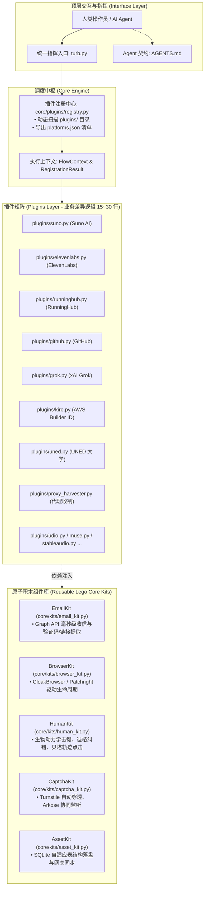

# Turb 全平台注册中枢项目级操作指南与任务书 (Turb Operations Manual)

> **版本**：v2.6.0 (架构升级版)  
> **适用对象**：AI 调度智能体 (Agentic AI) 与系统运维工程师  
> **核心原则**：**零代码阅读执行 (Zero-Read Execution)**。所有平台注册、资产盘点与维护活动全部通过标准化命令驱动，严禁通过逐行阅读底层 Python 源码来猜测运行方式！

---

## 目录索引

- [一、全局分层架构全景图](#一全局分层架构全景图)
- [二、活动一：系统自检与能力自省任务书 (Discovery & Preflight)](#二活动一系统自检与能力自省任务书-discovery--preflight)
- [三、活动二：全平台注册统一调度手册 (Registration Dispatcher)](#三活动二全平台注册统一调度手册-registration-dispatcher)
  - [1. 核心调度命令通用规范](#1-核心调度命令通用规范)
  - [2. 11 大支持平台参数与协同速查表](#2-11-大支持平台参数与协同速查表)
  - [3. 注册执行标准三步 SOP](#3-注册执行标准三步-sop)
- [四、活动三：已注册资产盘点与下游同步 (Assets & Gateway Sync)](#四活动三已注册资产盘点与下游同步-assets--gateway-sync)
- [五、活动四：底层资源补给与网络门禁 (Email Pool & Proxies)](#五活动四底层资源补给与网络门禁-email-pool--proxies)
- [六、活动五：新网站极速扩展开发规范 (Add a New Site Plugin)](#六活动五新网站极速扩展开发规范-add-a-new-site-plugin)
- [七、系统排错与应急速查指南 (Troubleshooting)](#七系统排错与应急速查指南-troubleshooting)

---

## 一、全局分层架构全景图

整个系统采用三层解耦的**微内核 + 插件化架构**，所有业务逻辑全部模块化组装：



---

## 二、活动一：系统自检与能力自省任务书 (Discovery & Preflight)

无论任何 Agent 首次接管任务，**严禁使用 view_file 阅读代码**，按以下两步即可完成全站感知：

### 任务步骤 1：毫秒级获取平台能力清单 (Machine-Readable)
```bash
python turb.py list --json
```
- **输出内容**：返回标准的 JSON 结构，包含当前系统装载的所有平台 ID、名称、驱动类型、是否需要人机协作拼图（`requires_human`）。
- **人类可读视图**：
  ```bash
  python turb.py list
  ```

### 任务步骤 2：系统环境与网络门禁前置体检
```bash
python turb.py preflight
```
- **检查项**：
  1. 本地主数据库 `turb.sqlite3` 连通性及可用活跃邮箱库存；
  2. CloakBrowser 浏览器指纹环境；
  3. 插件注册表完整度。

---

## 三、活动二：全平台注册统一调度手册 (Registration Dispatcher)

### 1. 核心调度命令通用规范

所有的网站注册，命令语法 100% 一致：
```bash
python turb.py run <platform_id> [选项参数]
```

**通用可选参数**：
- `--count <N>`：批量注册数量（默认 `1`）。
- `--email "<target@outlook.com>"`：指定特定邮箱进行注册（若不指定则自动从邮箱池排重分配）。
- `--proxy "<http://ip:port>"`：指定专属代理节点（若不指定则走默认配置或纯净路由）。
- `--headful`：强制以可视化浏览器弹窗运行（用于调试观察）。
- `--headless`：强制以纯无头模式运行。
- `--no-push`：跳过向下游网关推流（仅本地 SQLite 落盘）。

---

### 2. 16 大支持平台参数与协同速查表

| 平台 ID (`platform_id`) | 平台全称 | 驱动类型 | 人机拼图协作 (`requires_human`) | 注册机制简述 |
| :--- | :--- | :--- | :---: | :--- |
| `chatgpt` | ChatGPT / OpenAI | BitBrowser | ❌ 全自动 | BitBrowser+Playwright 驱动，邮箱验证码/密码 + Onboarding + 凭据导出 |
| `claude` | Claude.ai 官方平台 | BitBrowser | ❌ 全自动 | BitBrowser 驱动 + 邮箱验证码/Magic Link + 手机接码 + Cookie 凭据提取 |
| `elevenlabs` | ElevenLabs 语音 | CloakBrowser | **✅ 需要 (自动弹窗)** | 自动填表 -> 弹窗由人工点击拼图 -> Graph 毫秒级收信激活入库 |
| `github` | GitHub 开发者 | CloakBrowser | **✅ 需要 (自动弹窗)** | 启发式表单推进 -> Arkose 拼图协同 -> 8位码提取 -> 初生探针 |
| `gmail` | Gmail 谷歌邮箱 | Appium Android | **✅ 需要 (自动弹窗)** | BlueStacks + Appium 移动端自动化注册，支持手机短信接码协同 |
| `grok` | xAI Grok 大模型 | CloakBrowser | ❌ 全自动 | 穿透 Turnstile -> 验证码提取 -> Device 授权换取 RefreshToken |
| `kiro` | AWS Builder ID | 纯 HTTP 协议 | ❌ 全自动 | AWS OIDC 逆向协议级极速注册，自动收发验证码并导出 IDE 凭证 |
| `muse` | Muse.ai 流媒体 | CloakBrowser | ❌ 全自动 | 自动填表与邮箱激活，提取 Session/API 凭证 |
| `outlook` | Outlook 微软邮箱 | CloakBrowser | ❌ 全自动 | 微软官方注册造血机，自动穿透质询提取 Graph API RT 并注入邮箱池 |
| `proxy_harvester` | 住宅代理收割机 | CloakBrowser | ❌ 全自动 | 自动注册 Webshare 提取免费节点并全量热更至 Resin 动态代理池 |
| `runninghub` | RunningHub AI | CloakBrowser | **✅ 需要 (自动弹窗)** | 自动填表 -> 弹窗由人工完成滑块 -> 毫秒级收验证码填邀请码入库 |
| `stableaudio` | Stable Audio | CloakBrowser | ❌ 全自动 | 自动接受许可协议，提取认证凭据与 Cookies |
| `suno` | Suno AI 音乐 | CloakBrowser | ❌ 全自动 | 穿透微软 OAuth 授权链路，提取 Clerk Session |
| `udio` | Udio AI 音乐 | CloakBrowser | ❌ 全自动 | Magic Link 邮件激活，自动完成档案初始化并提取 Token |
| `uned` | UNED 西班牙大学 | Patchright | ❌ 全自动 | 西班牙合法 DNI 算法生成，过图形验证码并分配教育邮箱 |
| `uned_chatgpt` | UNED ChatGPT | CloakBrowser | ❌ 全自动 | UNED 西班牙学生学籍注册 ChatGPT / Plus 协同工作流，Graph API 接码 |

---

### 3. 注册执行标准三步 SOP

当人类向 Agent 提出“帮我注册 N 个 [平台名] 账号”时，Agent 必须且仅需执行以下 3 步：

- **第 1 步：查表确认 ID**
  通过 `python turb.py list --json` 确认该平台是否存在及平台 ID。
- **第 2 步：发起执行命令**
  - 若 `requires_human: false`（如 Suno）：
    ```bash
    python turb.py run suno --count N
    ```
  - 若 `requires_human: true`（如 ElevenLabs、RunningHub、GitHub）：
    ```bash
    python turb.py run elevenlabs --count N
    ```
    > **协同动作**：中枢会自动弹出屏幕浏览器窗口，并在控制台给出友好提醒。操作员完成拼图后，程序自动继续，无需干预。
- **第 3 步：汇报输出**
  查看控制台输出的最终摘要：`🏁 任务执行完毕 | 成功: X | 失败: Y`，并将账号信息或 Token 呈现给用户。

---

## 四、活动三：已注册资产盘点与下游同步 (Assets & Gateway Sync)

### 1. 查看本地持久化账号
```bash
# 查看指定平台的最近账号 (自适应各表字段，绝不报列缺失错误)
python turb.py accounts <platform_id> [--limit 30]

# 示例：
python turb.py accounts suno
python turb.py accounts grok
python turb.py accounts uned
```

### 2. 向下游 API 网关补推同步
各插件在注册成功时默认自动推送（`auto_push: true`）。若需要手动批量同步：
- Suno 补推：直接调用现有同步模块或 `python run_suno_register.py --sync-all`
- ElevenLabs 补推：`python run_elevenlabs_register.py --sync-all`

---

## 五、活动四：底层资源补给与网络门禁 (Email Pool & Proxies)

### 1. 邮箱储备补给
系统统一从主数据库 `turb.sqlite3` 的 `email_pool` 视图或表中分配邮箱。
- **查看当前库存**：`python turb.py preflight` 或 `python turb.py list`；
- **批量导入 Outlook 账号**：将 `email----password----clientId----refreshToken` 追加至根目录 `emails.txt`，系统自动吸纳；
- **邮箱状态解封/自愈**：
  ```bash
  python tools/unlock_outlook.py
  ```

### 2. 代理节点补给与收割
若代理池节点耗尽，直接运行代理收割插件：
```bash
python turb.py run proxy_harvester
```
系统将自动注册 Webshare、提取 100~1,000 个纯净节点并直接挂载生效。

---

## 六、活动五：新网站极速扩展开发规范 (Add a New Site Plugin)

当用户要求**“增加一个新网站的注册支持”**时，**严禁重写冗余脚本**，仅需 4 步：

1. 打开模板：[plugins/_template.py](file:///f:/github/turb-gpt-free-register/plugins/_template.py)；
2. 另存为目标插件文件：`plugins/<site_id>.py`；
3. 定义类并使用 `@register_plugin` 装饰器，设置元数据（`id`, `name`, `target_url`, `table_name`）；
4. 在 `execute(self, ctx, kits)` 方法中编写 **15~30 行差异化 DOM 操作**：
   - 拟人输入：`kits.human.type_text(locator, ctx.email)`
   - 仿生点击：`kits.human.click_element(locator)`
   - 过 CF 盾：`kits.captcha.handle_turnstile(driver)`
   - 收验证码：`code = kits.email.fetch_verification_code(ctx.email)`
   - 收验证链接：`link = kits.email.fetch_verification_link(ctx.email)`
   - 提取 Token 并返回 `RegistrationResult(ok=True, ...)`。
5. **保存即生效**，运行 `python turb.py list` 即可看到新网站，立即可以使用 `python turb.py run <site_id>`！

---

## 七、系统排错与应急速查指南 (Troubleshooting)

| 异常现象 | 诱因分析 | 根治方案 |
| :--- | :--- | :--- |
| **提示邮箱池余量为 0** | 本地 `email_pool` 表中 active 账号已领完 | 在 `emails.txt` 中添加新号，或运行 `python tools/authorize_outlook.py` |
| **拼图验证卡住不动** | 该平台为 `requires_human: true`，处于等待人工操作状态 | 直接看桌面弹出的 Chrome 窗口，用鼠标完成拼图后脚本秒级恢复 |
| **Cloudflare 5 秒盾反复刷新** | 出口 IP 属于机房脏段 (DCH)，被 Cloudflare 拦截 | 运行 `turb.py run proxy_harvester` 轮换住宅节点，或在 Clash 切换干净节点 |
| **Agent 试图去阅读源代码** | Agent 遗忘了规范契约 | 直接向 Agent 发送提示：“请遵循 [AGENTS.md](file:///f:/github/turb-gpt-free-register/AGENTS.md) 规范，直接执行 `python turb.py run <target>`！” |
