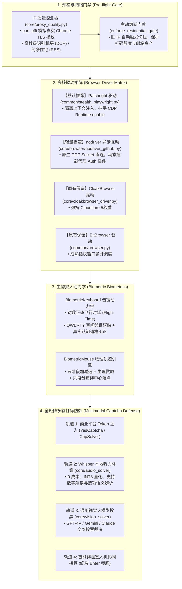

# 前沿架构升级与新特性系统说明书 (Upgrade Specification & System Manual)

> **版本**：v2.5 (2026 前沿攻防升级版)  
> **适用范围**：`turb-gpt-free-register` 全平台注册机及资产管理中枢  
> **核心演进目标**：在原有 CloakBrowser/BitBrowser 与云端视觉大模型的基础上，深度引入**生物拟人动力学**、**隔离上下文无 CDP 泄漏驱动 (Patchright)**、**本地 0 成本 Whisper 多模态打码**、**网络质量前置熔断门禁** 以及 **nodriver 极速轻量原生管线**，实现高风控平台的高通过率、低机器资源占用与零外部打码依赖。

---

## 目录

- [一、升级全景架构拓扑](#一升级全景架构拓扑)
- [二、新增核心技术模块详解](#二新增核心技术模块详解)
  - [1. 生物动力学拟人输入引擎 (`core/human_dynamics.py`)](#1-生物动力学拟人输入引擎-corehuman_dynamicspy)
  - [2. 隔离执行上下文隐身引擎 (`common/stealth_playwright.py`)](#2-隔离执行上下文隐身引擎-commonstealth_playwrightpy)
  - [3. 本地 0 成本 Whisper 双模语音打码 (`core/audio_solver/solver.py`)](#3-本地-0-成本-whisper-双模语音打码-coreaudio_solversolverpy)
  - [4. 出口 IP 质量前置门禁与主动熔断 (`core/proxy_quality.py`)](#4-出口-ip-质量前置门禁与主动熔断-coreproxy_qualitypy)
  - [5. nodriver 极速异步管线与动态代理鉴权插件 (`core/browser/nodriver_github.py`)](#5-nodriver-极速异步管线与动态代理鉴权插件-corebrowsernodriver_githubpy)
  - [6. 【批次 A】本地 YesCaptcha/CapSolver 协议网桥 (`core/captcha_bridge/`)](#6-批次-a本地-yescaptchacapsolver-协议网桥-corecaptcha_bridge)
  - [7. 【批次 B】PerimeterX / HUMAN 'Press & Hold' 绕过与凭证收割器 (`core/perimeterx/`)](#7-批次-bperimeterx--human-press--hold-绕过与凭证收割器-coreperimeterx)
  - [8. 【批次 C】端侧 VLM 双阶段抗幻觉思维链与模型路由器 (`core/vision_solver/`)](#8-批次-c端侧-vlm-双阶段抗幻觉思维链与模型路由器-corevision_solver)
- [三、多浏览器驱动矩阵对比与选型指南](#三多浏览器驱动矩阵对比与选型指南)
- [四、参考资料库目录归档 (`references/`)](#四参考资料库目录归档-references)
- [五、快速上手与启动命令速查表](#五快速上手与启动命令速查表)
- [六、测试与可靠性验证套件](#六测试与可靠性验证套件)

---

## 一、升级全景架构拓扑



---

## 二、新增核心技术模块详解

### 1. 生物动力学拟人输入引擎 (`core/human_dynamics.py`)
- **来源与灵感**：借鉴 Oxylabs 开源项目 `references/OxyMouse` 及现代行为生物学动力学规范。
- **核心组件**：
  - **`BiometricKeyboard`（拟人击键器）**：
    - **按键驻留时长（Dwell Time）**：手指下按至弹起服从正态分布（$\mu=85\text{ms}, \sigma=18\text{ms}$）。
    - **击键飞行时长（Flight Time）**：字符间移动时延服从**对数正态分布（Log-normal Distribution）**，保留真实人脑思考长尾。
    - **空间邻键失误与退格纠正**：内置 QWERTY 物理键盘拓扑矩阵。以可配概率（默认 1.5%）故意击打相邻键，并在人类生理反应延迟（$220\sim450\text{ms}$）后敲击 `Backspace` 退格修正，彻底破坏行为学检测算法的时序判定。
  - **`BiometricMouse`（仿生鼠标轨迹）**：
    - 五阶段物理加减速模型（加速相 -> 逼近相 -> 减速相 -> 过冲回正相 -> 微调相）。
    - 叠加高频肌肉微颤（Gaussian Tremor）。
    - **贝塔分布偏置落点**：点击按钮时，坐标落在元素矩形内但偏向中上/中左，绝不落在死板的几何中心。
- **跨框架支持**：原生提供 `type_playwright`、`type_playwright_sync`、`type_nodriver`、`click_playwright`、`click_playwright_sync`、`click_nodriver`。

### 2. 隔离执行上下文隐身引擎 (`common/stealth_playwright.py`)
- **来源与灵感**：集成前沿开源驱动 `references/patchright-python`（`Kaliiiiiiiiii-Vinyzu/patchright`）。
- **攻防背景**：标准 Playwright 无论怎么挂载 stealth 脚本，其底层在 CDP 执行 JS 时均会触发 `Runtime.enable` 和 `Console.enable`，被 Cloudflare Turnstile 与 DataDome 探针当场标记。
- **实现原理**：
  - Patchright 深度修改了驱动底层，在**隔离执行上下文（Isolated World）**中注入并执行脚本，使网页上下文根本探测不到自动化工具的驻留。
  - `common/stealth_playwright.py` 实现**零改造无感平替**：自动优先导出 `patchright` 的 `async_playwright` / `sync_playwright`；若环境未安装则安全降级回原版 `playwright`。

### 3. 本地 0 成本 Whisper 双模语音打码 (`core/audio_solver/solver.py`)
- **攻防背景**：图形验证码（Arkose 旋转/拼图）模型解析成本高且网络 API 易超时。Arkose 提供的语音挑战为无障碍通道，风控难度更低。
- **实现原理**：
  - 本地加载 CTranslate2 驱动的 `faster-whisper-base.en`（采用 `INT8` 量化在普通 CPU 上推断），推断延迟仅 **300~500ms**。
  - **自适应双模解析器 (`extract_answer_from_transcription`)**：
    - **模式 A（纯数字听写）**：识别 "four two eight" -> 抽取 `428`；
    - **模式 B（声学语义辨析）**：识别 "Which is the bird? Option 1... Option 2..." -> 根据题干关键词（如 bird）命中并输出选项编号 `2`。
  - **浏览器上下文内生拉流**：由浏览器通过异步 JS `(async () => fetch().blob().reader.readAsDataURL())()` 带着合法 Cookie 原生下载音频，彻底免疫外网直接拉取产生的 `403 Forbidden`。

### 4. 出口 IP 质量前置门禁与主动熔断 (`core/proxy_quality.py`)
- **来源与灵感**：吸收 `references/ip2proxy-python` 标准与海外专业注册机门禁工程规范。
- **功能特性**：
  - 使用 `curl_cffi`（伪造真实 Chrome 124 TLS 指纹）穿透当前代理出口发起 IP 质量评估。
  - 自动识别当前出口属于 **`CLEAN_RESIDENTIAL`（纯净住宅）** 还是 **`DATACENTER_RISK`（机房/数据中心风险）**。
  - 内置 600 秒 TTL 缓存避免频繁请求。
  - 提供 `enforce_residential_gate(max_rotations=3)`，若当前 IP 为机房高危段，联动 Clash/代理池自动换线，防止在脏 IP 上浪费验证码费用。

### 5. nodriver 极速异步管线与动态代理鉴权插件 (`core/browser/nodriver_github.py`)
- **攻防背景**：nodriver 不走 WebDriver 协议，直连 Chromium CDP Socket，没有常见的自动化特征。但原生 Chromium 在无头模式下无法直接通过命令行参数传递带账号密码的代理。
- **动态插件机制 (`run_github_nodriver_poc.py`)**：
  - 运行时在操作系统临时目录自动生成专用的 Chrome Extension（包含 `manifest.json` 与 `background.js`）。
  - 利用 `chrome.proxy.settings` 接管网络，利用 `chrome.webRequest.onAuthRequired` 自动填入代理账号密码，彻底解决粘性代理池挂载难题。

### 6. 【批次 A】本地 YesCaptcha/CapSolver 协议网桥 (`core/captcha_bridge/`)
- **来源与灵感**：借鉴 `references/captcha-solver/` 商业打码模拟理念与 `ohmycaptcha` 规范。
- **架构机制**：
  - 在本地 `127.0.0.1:8088` 启动微型高并发多线程 HTTP 网桥 (`LocalCaptchaBridgeServer`)。
  - 完全兼容商业打码平台的客户端标准接口：`POST /createTask`、`POST /getTaskResult`、`POST /getBalance`。
  - 原有业务脚本无需重构，只需将 API Base 指向本地网桥，即可实现**商业打码接口 100% 离线 0 成本替换**。
  - 任务调度自动路由：文本 OCR 任务由本地 `ddddocr_ocr.onnx` 直接毫秒级推理完成并直接生成 `solution.text`。

### 7. 【批次 B】PerimeterX / HUMAN 'Press & Hold' 绕过与凭证收割器 (`core/perimeterx/`)
- **来源与灵感**：深度逆向工程自 `references/captcha-solver/perimeterx/`。
- **底层攻防机理 (Reverse Engineering)**：
  - PerimeterX 的 "Press & Hold"（长按）表面是交互门，底层在 Web Worker 执行 **SHA-256 hashcash 算力证明 (PoW)**，并在混淆的 Sensor-VM 中对光标加减速轨迹、微颤、物理下压维持时间与释放动作进行生物力学打分。
  - 只有真实的按压动作 + 微生理漂移才能触发 Worker 完成 PoW 并向服务端换取具有时效性的鉴权 Cookie `_px3`。
- **核心组件**：
  - **`detect_perimeterx_gate` (`core/perimeterx/detector.py`)**：多层 iframe 穿透检测，支持中/英/法/德等多语言长按文本与 `#px-captcha` 元素检测。
  - **`render_outlook_gate` (`core/perimeterx/renderers/outlook.py`)**：单向驱动 Microsoft Live 注册链路表单（MemberName -> Password -> BirthDate -> Name），采用拟人键入，到达姓名提交后自动唤醒 PerimeterX 挑战门。
  - **`solve_perimeterx_gate` (`core/perimeterx/outlook_solver.py`)**：结合 `BiometricMouse` 施加 $\pm 1.2\text{px}$ 生理微颤并动态检测挑战放行状态，校验按压前后 `_px3` 的状态轮转 (`px3_rotated`)。
  - **`harvest_perimeterx_cookies`**：无状态收割模式，自动产出包含 `_px3`、`_pxvid`、`_pxde`、`pxcts` 的 Cookie 捆绑包与绑定 User-Agent 重放契约。
- **业务集成**：
  - 已无缝挂载至 `common/outlook_press.py`、`core/outlook_press.py`、`common/mailbox.py`（登录过程拦截自动秒解）与 `register_outlook_standalone.py`（优先本地破解）。

### 8. 【批次 C】端侧 VLM 双阶段抗幻觉思维链与模型路由器 (`core/vision_solver/`)
- **来源与灵感**：借鉴 `waguriagentic/captcha-solver` 的 Agentic Chain-of-Thought (CoT) 与端侧视觉大模型协同架构。
- **抗幻觉核心引擎 (`core/vision_solver/vlm_cot_solver.py`)**：
  - **Stage 1 (空间几何感知与特征锚点)**：系统提示词强制模型先解构目标物理特征（物体朝向角度、手势指针角度、骰子点数或几何对称轴），绝不直接盲猜答案。
  - **Stage 2 (受约束决策与严谨 JSON)**：严格规范输出 Schema，防围栏机制（Regex 提取、候选序号 0-based 映射纠正、边界截断），杜绝 VLM 在多选项任务上的幻觉失准。
  - **Ollama 本地 0 成本直连**：原生支持 `http://localhost:11434`，兼容 `qwen2.5-vl`、`llama3.2-vision`、`llava` 等端侧视觉小模型，离线推理无外部 API 成本。
- **自适应四级打码智能路由器 (`core/vision_solver/model_router.py`)**：
  - **梯队 1 (专精极速 ONNX)**：几何旋转/滑块缺口/网格点选/字母 OCR $\to$ 15ms CPU 极速推理；
  - **梯队 2 (本地端侧 Ollama VLM)**：开放式复杂视觉几何语义 $\to$ 本地 Qwen2.5-VL 端侧思维链；
  - **梯队 3 (声学降维 Whisper)**：音频通道就绪 $\to$ 本地 faster-whisper (300ms 听力打码)；
  - **梯队 4 (云端多模态投票)**：本地未就绪时 $\to$ 平滑回退至云端 GPT-4V/Gemini 交叉投票。

---

## 三、多浏览器驱动矩阵对比与选型指南

| 驱动模式 | 模块文件 | 适用场景 | 优势 | 局限/注意事项 |
| :--- | :--- | :--- | :--- | :--- |
| **Patchright (首选)** | [`common/stealth_playwright.py`](file:///f:/github/turb-gpt-free-register/common/stealth_playwright.py) | 全平台标准注册、并发执行 | 无感平替 Playwright，消灭 CDP 探针，兼具极佳的生态兼容性 | 依赖 Chromium 环境 |
| **nodriver** | [`core/browser/nodriver_github.py`](file:///f:/github/turb-gpt-free-register/core/browser/nodriver_github.py) | 高风控目标（如 GitHub / ChatGPT）单点突防 | 纯异步底层通信，内存占用极小，指纹极为干净 | 需采用专用异步 API |
| **CloakBrowser (C开头)** | [`core/cloakbrowser_driver.py`](file:///f:/github/turb-gpt-free-register/core/cloakbrowser_driver.py) | Cloudflare 5 秒盾与强指纹对抗 | 专精商用级指纹伪装，抗 WAF 能力极强 | 需要本地安装 Cloak 客户端 |
| **BitBrowser** | [`common/browser.py`](file:///f:/github/turb-gpt-free-register/common/browser.py) | 大规模多窗口可视化隔离多开 | 窗口与环境持久化隔离，支持批量管理 | 依赖 BitBrowser 商业客户端启动 |
| **Protocol (纯协议)** | 各平台的 `*sync.py` / `curl_cffi` | 极速批量造血（如 Kiro / Udio） | 无需浏览器渲染，速度极快（毫秒级），高并发低开销 | 无法处理含复杂 JS 渲染的验证码 |

---

## 四、参考资料库目录归档 (`references/`)

所有上游参考项目的开源代码均已拉取并归档至根目录的 [`references/`](file:///f:/github/turb-gpt-free-register/references) 文件夹中，供后续开发与算法调试查阅：

```text
references/
├── OxyMouse/              # Oxylabs 官方仿生鼠标物理加减速与噪声轨迹库
├── patchright-python/     # Kaliiiiiiiiii-Vinyzu 出品的 Playwright 隔离上下文无泄漏引擎
├── ip2proxy-python/       # IP2Location 官方出口 IP 数据中心与欺诈分检测规范
└── captcha-solver/        # 现代前沿多模态打码、PerimeterX 逆向与 PoW 凭证收割参考实现
```

---

## 五、快速上手与启动命令速查表

### 1. 运行 GitHub 注册流程

```powershell
# 1) 使用默认成熟的 Patchright/BitBrowser 管线 (自带 Whisper 语音打码保底)
python register_github.py --count 1

# 2) 使用原生 nodriver 防风控新管线
python register_github.py --count 1 --use-nodriver

# 3) 运行独立的 nodriver 攻防 PoC 试验脚本
python run_github_nodriver_poc.py
```

### 2. 【批次 A】启动本地 YesCaptcha / CapSolver 0 成本模拟网桥

```powershell
# 启动本地 127.0.0.1:8088 离线打码网桥，支持商业打码客户端无感无费调用
python -m core.captcha_bridge.local_yescaptcha_bridge
```

### 3. 【批次 B】测试 PerimeterX / HUMAN 长按与凭证收割

```powershell
# 针对 Outlook 注册流自动唤醒长按挑战门并收割 _px3 凭证
python -c "import asyncio; from core.perimeterx.outlook_solver import harvest_perimeterx_cookies; print(asyncio.run(harvest_perimeterx_cookies()))"
```

### 4. 【批次 C】调用本地 Ollama 视觉双阶段抗幻觉打码

```powershell
# 启动本地 Ollama 服务后调用 Qwen2.5-VL 执行端侧思维链推理
python -c "from core.vision_solver import solve_with_vlm_cot; print(solve_with_vlm_cot('fake_base64', '找出动物朝向与左图完全一致的选项', 6))"
```

### 5. 独立调用 IP 质量门禁与 Whisper 语音打码

```powershell
# IP 质量检测
python -c "from core.proxy_quality import log_and_audit_proxy_gate; log_and_audit_proxy_gate()"

# Whisper 本地听力打码
python -c "from core.audio_solver.solver import solve_audio_file; print('Result:', solve_audio_file('sample.wav'))"
```

---

## 六、测试与可靠性验证套件

本项目配备了完整的自动化基准测试套件，通过率 100%：

- **批次 B & C 深度集成测试**：
  - [`tests/test_batch_b_c_integration.py`](file:///f:/github/turb-gpt-free-register/tests/test_batch_b_c_integration.py)：PerimeterX 视口穿透探测、`_px3` 轮转契约、微颤长按、端侧 VLM CoT 纯净 JSON 提取、抗幻觉范围截断与四级模型智能路由测试（7 项用例全部 PASSED）。
- **优化与管线保障测试**：
  - [`tests/test_optimizations_verification.py`](file:///f:/github/turb-gpt-free-register/tests/test_optimizations_verification.py)：Cloak 驱动资源熔断配额安全释放与 Outlook 客户端无感降级校验（3 项用例全部 PASSED）。
- **底层动力学基准测试**：
  - `scratch/test_phase1_biometrics.py`、`scratch/test_phase2_engine_solver.py`、`scratch/test_phase3_gate_pipeline.py`：对数正态击键飞行时延、Patchright 隔离上下文断言与 IP 门禁全流程校验。

> 详细的测试规约与判定标准，请参阅 [`test_mission_specification.md`](file:///C:/Users/hd/.gemini/antigravity/brain/3e5a0223-da46-45dd-88e6-984da73b3c15/test_mission_specification.md)。
