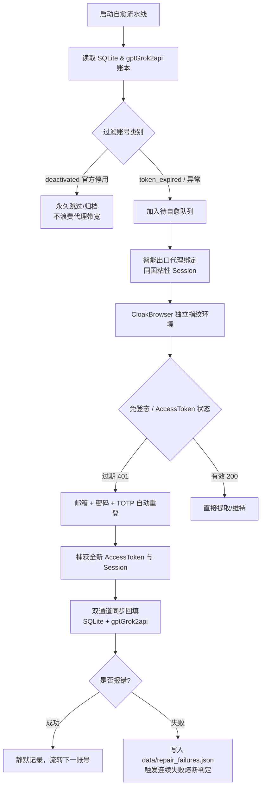

# 账号自动化自愈恢复标准规范 (Account Self-Healing SOP)

> **原则**：**低交互、零干扰、错误驱动（Exception-Driven）**。日常批量执行时不反复读取繁杂的过程日志与状态轮询，任务静默自主流转；只在发生异常报错（如严重风控、密码失效、节点彻底熔断）时进行报警与专项排查。

---

## 1. 核心运行架构与工作原理



---

## 2. 标准自愈执行命令 (CLI)

### 常用一键指令

1. **一键启动全自动自愈模式 (推荐日常使用)**
   ```powershell
   python scripts/repair_accounts.py --auto-heal --headed
   ```
   - 自动扫描所有处于 401 `token_expired`、未激活或上游同步异常的账号。
   - 自动忽略已被 OpenAI 官方永久封禁（`deactivated`）的账号。
   - 采用有头模式（`--headed`）确保极高过盾率。
   - 成功账号单行轻量确认，全量自动回写数据库与 `gptGrok2api` 网关。

2. **限制批次规模运行 (如每次自愈 10 个)**
   ```powershell
   python scripts/repair_accounts.py --auto-heal --headed --limit 10
   ```

3. **指定账号 ID 定向修复 (针对特定异常排查)**
   ```powershell
   python scripts/repair_accounts.py --ids 55 56 57 --headed
   ```

4. **深度拟人交互养号 (自愈 + 2 轮自然对话问答)**
   ```powershell
   python scripts/repair_accounts.py --ids 54 55 56 --headed --dialogue --turns 2
   ```

---

## 3. 错误驱动响应机制 (报错再介入)

在自愈流程运行期间，**不需要频繁读取日志或人工干预过程**。系统具备完整的错误捕获与自愈隔离：

### 失败归档文件：`data/repair_failures.json`
当任意账号在自愈过程中遇到异常（如密码错误、2FA失效、Cloudflare质询阻断等），系统将自动将其记录至 `data/repair_failures.json`：
```json
[
  {
    "id": 88,
    "email": "example@outlook.com",
    "error": "Cloudflare challenge timeout / Password mismatch",
    "timestamp": "2026-10-03 11:20:00"
  }
]
```

### 自动熔断保护
- 默认设置连续失败阈值 `--max-consecutive-fails 5`。
- 若因出口网络全局瘫痪导致连续 5 个账号自愈失败，流水线自动主动熔断中止，防止无效消耗代理带宽与触发连锁风控。

### 人工介入场景
只有在满足以下条件之一时，才需要人工或 Agent 介入排查：
1. 自愈脚本退出并提示存在失败账号（查看 `data/repair_failures.json`）。
2. 触发全局熔断告警（排查 Clash 节点或 Resin 代理链路）。
3. 提示账号已被官方判定为不可逆的永久封禁（标记为 `deactivated` 归档）。

---

## 4. 账号生命周期与状态基准

| 状态码 (`live_check_status`) | 含义 | 处理策略 |
| :--- | :--- | :--- |
| `live` | 会话正常在线，JWT 处于有效期 | 正常使用，自动参与 `gptGrok2api` 负载均衡调度。 |
| `token_expired` | 凭据自然过期（10~14 天官方生命周期），资产完好 | **本自愈模式核心目标**：一键自动补登换取新 Token。 |
| `deactivated` | 账号被 OpenAI 官方永久停用（违规/封号） | **永久跳过**，系统自动识别并归档，绝不重复尝试。 |
| `failed` | 密码/TOTP 不匹配或网络彻底阻断 | 写入失败清单，按需人工复核或核对密码本。 |
