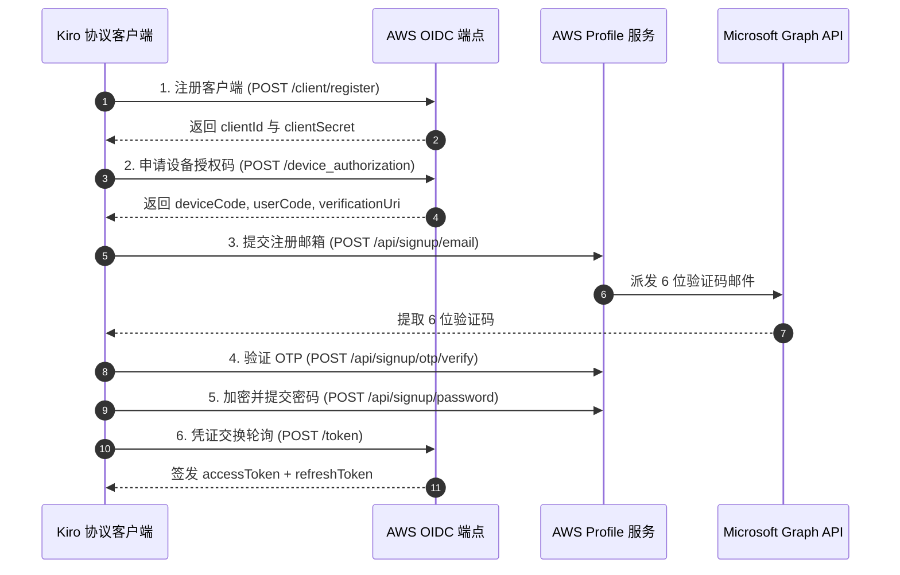

# 逆向工程技术规范：Kiro / AWS Builder ID 纯协议全自动注册与凭证提取链路

> **文档状态**：已完成逆向验证（Verified - Pure HTTP Protocol）  
> **更新时间**：2026-10-08  
> **目标服务**：AWS Builder ID / Kiro API (`https://oidc.us-east-1.amazonaws.com`)  
> **交付标的**：AWS OIDC Access Token + Refresh Token + Kiro CLI 凭证  

---

## 一、 系统架构与纯 HTTP 协议特征

* **核心优势**：**无浏览器驱动依赖**（100% Pure HTTP Protocol 实现，资源消耗仅为 Playwright 的 1/20）。
* **通信协议**：基于 `curl_cffi` 实现 TLS 指纹模拟（`impersonate="chrome131"`），穿透 AWS CloudFront WAF。
* **业务标准**：RFC 8628 OAuth 2.0 Device Authorization Grant + AWS IAM Identity Center (SSO)。
* **适用工具**：Kiro 编辑器、Amazon Q Developer CLI、CodeWhisperer。

---

## 二、 纯协议端点与认证时序



---

## 三、 底层 HTTP 接口契约详解

### 1. 客户端注册 (Client Registration)
* **Method**: `POST`
* **URL**: `https://oidc.us-east-1.amazonaws.com/client/register`
* **Payload**:
  ```json
  {
    "clientName": "Amazon Q Developer for command line",
    "clientType": "public",
    "scopes": [
      "codewhisperer:completions",
      "codewhisperer:analysis",
      "codewhisperer:conversations",
      "codewhisperer:transformations",
      "codewhisperer:taskassist"
    ]
  }
  ```
* **Response**: `{"clientId": "...", "clientSecret": "..."}`

### 2. 申请设备授权 (Device Authorization)
* **Method**: `POST`
* **URL**: `https://oidc.us-east-1.amazonaws.com/device_authorization`
* **Payload**:
  ```json
  {
    "clientId": "<client_id>",
    "clientSecret": "<client_secret>",
    "startUrl": "https://view.awsapps.com/start"
  }
  ```
* **Response**: `{"deviceCode": "...", "userCode": "...", "verificationUri": "..."}`

### 3. 密码加密与注册提交
* **算法实现**：`common/kiro_crypto.py` 中的 `encrypt_password()`。
* **URL**: `https://profile.aws.amazon.com/api/signup/password`
* **提交字段**：包含时间戳指纹、公钥加密后的密码密文。

### 4. Token 交换与长效持久化
* **Method**: `POST`
* **URL**: `https://oidc.us-east-1.amazonaws.com/token`
* **Payload**:
  ```json
  {
    "clientId": "<client_id>",
    "clientSecret": "<client_secret>",
    "grantType": "urn:ietf:params:oauth:grant-type:device_code",
    "deviceCode": "<device_code>"
  }
  ```
* **Response**:
  ```json
  {
    "accessToken": "...",
    "refreshToken": "...",
    "tokenType": "Bearer",
    "expiresIn": 28800
  }
  ```

---

## 四、 资产交付与格式规范

提取的凭证直接格式化为标准的 `kiro-rs` 与 `AWS SSO` 兼容格式：
```json
{
  "email": "user@outlook.com",
  "client_id": "...",
  "access_token": "...",
  "refresh_token": "...",
  "expires_at": "2026-10-09T04:59:00Z"
}
```
自动落盘至 `data/kiro_accounts.json`，支持供下游代码智能体并发调度消费。
