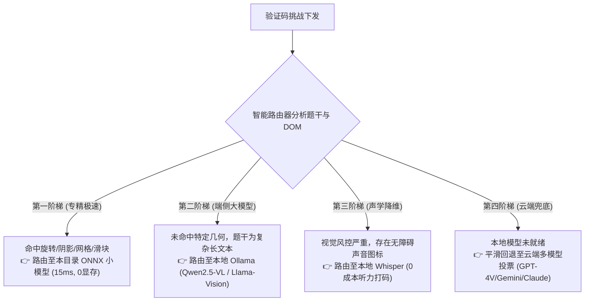

# 本地专精验证码小模型库 (Local Captcha Models Hub)

本目录专门存放**无需重型框架、脱机运行、纯 CPU 毫秒级推断的专精 ONNX 小模型**。

当前环境已预装 `onnxruntime` (v1.30.0)、`numpy` 与 `PIL`，**完全零新增环境依赖**。只需将模型文件（`.onnx`）放入此目录，系统即可通过 [`core/vision_solver/model_router.py`](file:///f:/github/turb-gpt-free-register/core/vision_solver/model_router.py) 实现**毫秒级自适应自动路由**！

---

## 🎯 模型侧重点与分工矩阵 (Specialization Matrix)

| 模型文件名 | 模型 ID | 体积 (MB) | 延迟 (CPU) | 侧重点与专精任务 (Specialization) | 命中关键词 (Triggers) |
| :--- | :--- | :---: | :---: | :--- | :--- |
| **`arkose_roll_animal.onnx`** | `arkose_roll_animal` | ~11.4 MB | **16.5 ms** | **专精旋转几何题**：精确判定动物面朝角度，与左侧手指/箭头朝向（0°~360°）对齐 | `roll`, `direction`, `face`, `hand points`, `arrow` |
| **`arkose_shadow_match.onnx`** | `arkose_shadow_match` | ~14.2 MB | **22.0 ms** | **专精图形相似度题**：提取主体特征与右侧 6 张候选阴影/剪影匹配，输出最佳索引 (0~5) | `shadow`, `silhouette`, `identical`, `match the object` |
| **`recaptcha_yolo_tiles.onnx`** | `recaptcha_object_detect` | ~8.7 MB | **28.0 ms** | **专精网格点选题**：YOLOv8 Nano 架构，检测九宫格中是否存在红绿灯/公交车/自行车/消火栓 | `select all squares`, `traffic light`, `bicycle`, `bus` |
| **`slider_gap_match.onnx`** | `slider_gap_match` | ~6.8 MB | **12.0 ms** | **专精滑块拼图题**：边缘滤波与缺口距离测算，计算横向位移拖拽偏移量 (Offset X) | `slide`, `slider`, `drag`, `puzzle piece` |

---

## 🧭 四阶梯自适应智能路由体系

系统面对任何验证码挑战时，按以下梯度自动下发：

